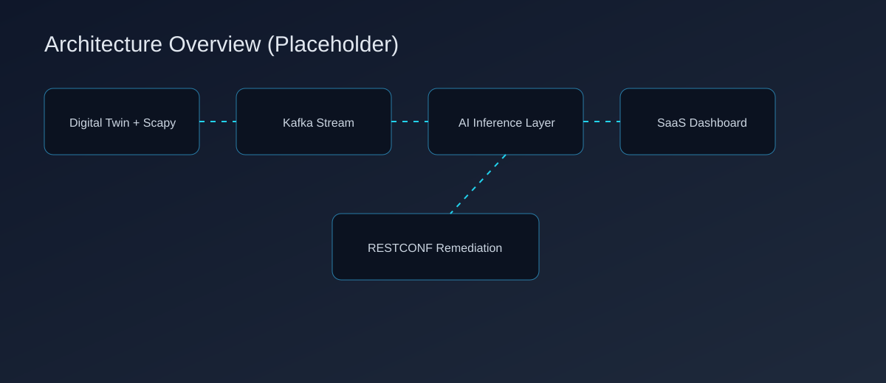
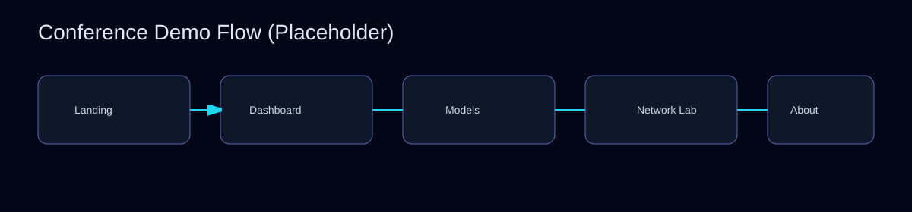

# AI-Driven Network Quality Prediction & Autonomous Remediation


Production-grade platform for real-time network telemetry, AI-based quality prediction, anomaly detection, topology-aware root-cause signals, and closed-loop RESTCONF remediation.

## Architecture Preview





## What This Project Does

- Captures flow-level telemetry and publishes it to Kafka.
- Runs live inference with PyTorch models:
  - BR-LSTM for latency/QoS prediction (`mu`, `sigma`)
  - CNN-BiLSTM for DDoS/anomaly probability
  - GNN-ready root-cause context in topology view
- Streams inference results to a React SaaS dashboard over WebSockets.
- Triggers automated remediation via RESTCONF for high threat scores.

## Tech Stack

- **Backend:** FastAPI, aiokafka, Redis, httpx, PyTorch
- **Frontend:** React, Vite, Tailwind CSS v4, Framer Motion, ECharts
- **Data Plane:** Kafka, Redis, PostgreSQL, ClickHouse (Docker Compose)
- **Simulation / Traffic:** Scapy edge agent, mock Kafka producer
- **Network Twin:** Containerlab topology (SR Linux)

## Repository Layout

```text
backend/                  FastAPI inference + websocket + remediation engine
frontend/                 React SaaS UI
edge_agents/              Scapy-based flow capture producer
ml_pipeline/              Model definitions, training scripts, saved weights
network_sim/              Containerlab topology
init-db/                  Postgres and ClickHouse init SQL
scripts/                  One-command bootstrap scripts (PowerShell + Bash)
docs/assets/              Architecture diagram placeholders
mock_traffic_producer.py  Synthetic Kafka flow generator
docker-compose.yml        Infra services (Kafka/Redis/Postgres/ClickHouse)
Makefile                  Task runner shortcuts
```

## Super Quick Start (Cake Walk)

### Option A: One Command (PowerShell - Windows)

```powershell
./scripts/dev-up.ps1 -WithMockTraffic
```

### Option B: One Command (Bash - Linux/macOS)

```bash
chmod +x scripts/dev-up.sh
./scripts/dev-up.sh --with-mock
```

### Option C: Makefile Task Runner

```bash
make up-mock
```

This will:

- start Docker infra
- install backend + frontend dependencies
- start backend (`uvicorn`) and frontend (`vite`)
- optionally start mock Kafka traffic

## Manual Setup (Step by Step)

### 1) Prerequisites

- Docker + Docker Compose
- Python 3.10+
- Node.js 20+
- Git

### 2) Clone

```bash
git clone https://github.com/SHIVAJIJAMADAR/Cn.git
cd Cn
```

### 3) Start Infrastructure

```bash
docker compose up -d kafka kafka-setup redis postgres clickhouse
docker compose ps
```

### 4) Backend Setup

```bash
python -m venv .venv
# Windows
.venv\Scripts\activate
# macOS/Linux
# source .venv/bin/activate

pip install -r backend/requirements.txt
pip install torch==2.2.0
```

If weights are missing, train once:

```bash
python ml_pipeline/scripts/train_all.py
```

Run backend:

```bash
uvicorn backend.main:app --host 0.0.0.0 --port 8000 --reload
```

Health endpoint:

```text
http://localhost:8000/health
```

### 5) Frontend Setup

```bash
cd frontend
npm install
npm run dev
```

Open:

```text
http://localhost:5173
```

### 6) Generate Live Telemetry

From repo root (new terminal, backend still running):

```bash
python mock_traffic_producer.py
```

## Full Data Flow

1. Edge telemetry (`flow_capture.py` or `mock_traffic_producer.py`) publishes to Kafka topic `network-telemetry-flows`.
2. FastAPI consumes Kafka events and preprocesses features.
3. BR-LSTM and CNN-BiLSTM run inference and enrich payload.
4. Payload is broadcast over WebSocket (`/ws/telemetry`) to the UI.
5. Redis TimeSeries stores selected metrics.
6. If threat score exceeds threshold, remediation is executed through RESTCONF calls.

## Remediation Configuration

Backend supports env-driven RESTCONF settings:

- `RESTCONF_USERNAME` (default: `admin`)
- `RESTCONF_PASSWORD` (default: `admin`)
- `RESTCONF_PORT` (default: `443`)
- `RESTCONF_VERIFY_TLS` (`true`/`false`, default `false`)
- `REMEDIATION_INTERFACE` (default `e1-1`)

Example (PowerShell):

```powershell
$env:RESTCONF_USERNAME="admin"
$env:RESTCONF_PASSWORD="admin"
$env:RESTCONF_VERIFY_TLS="false"
uvicorn backend.main:app --host 0.0.0.0 --port 8000 --reload
```

## Frontend Routes

- `/` Landing page
- `/app/dashboard` Live operational dashboard
- `/app/models` AI model intelligence view
- `/app/lab` Topology + backend stream visualizer
- `/app/alerts` Alert timeline
- `/app/settings` Runtime control panel
- `/app/about` Architecture documentation

## Makefile Commands

```bash
make help        # List commands
make up          # Start app stack
make up-mock     # Start app stack + mock traffic
make down        # Stop infra and local processes
make infra-up    # Start infra only
make infra-down  # Stop infra only
make logs        # Follow docker compose logs
```

## Optional: Real Packet Capture Path

```bash
pip install -r edge_agents/requirements.txt
python edge_agents/flow_capture.py
```

Requires packet capture privileges and suitable interface setup.

## Troubleshooting

- **No UI updates:** confirm backend is running and WebSocket URL is reachable.
- **All metrics zero:** start `mock_traffic_producer.py` or `flow_capture.py`.
- **Styles not loading:** run `npm install` in `frontend/` and restart Vite.
- **Model load warning:** run `python ml_pipeline/scripts/train_all.py`.
- **Kafka errors:** check `docker compose ps` and `kafka-setup` logs.

## License

For academic and demonstration use. Add your preferred license if publishing publicly.
